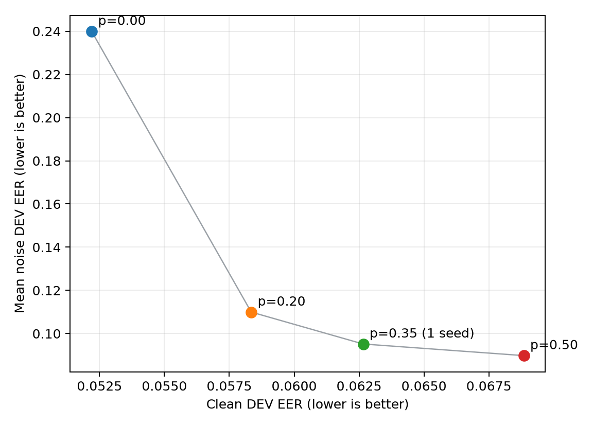

# Robust Synthetic Speech Detection under Audio Distribution Shift

A reproducible study of how a synthetic-speech detector behaves under compression,
resampling, and additive-noise distribution shift. A frozen WavLM detector performed
well on clean audio but degraded sharply under noise; controlled TRAIN-only
augmentation reduced held-out EER by **46–62%** at 20–5 dB while preserving about
**0.061 clean EER** on unseen spoofing attacks.

## Key results

Final results come from **71,237 official ASVspoof 2019 LA EVAL trials** containing
unseen attacks **A07–A19**. Checkpoints, thresholds, corruptions, metrics, and the
statistical protocol were committed before EVAL; there was no post-EVAL tuning.

| Condition | Clean-trained EER | Robust `p=0.20` EER | Relative EER reduction |
|---|---:|---:|---:|
| Clean | 0.0600 | 0.0609 ± 0.0004 | — |
| Noise 20 dB | 0.1406 | 0.0760 ± 0.0026 | 45.9% |
| Noise 10 dB | 0.2126 | 0.0960 ± 0.0046 | 54.8% |
| Noise 5 dB | 0.3154 | 0.1189 ± 0.0020 | 62.3% |

The paired 95% confidence interval for the clean EER difference crosses zero. All
noise-condition intervals show large gains in EER, ROC-AUC, balanced accuracy, and
F1. Robust values are the mean ± sample SD of three independently trained heads;
prediction scores were not ensembled.


## Why this project

Synthetic-speech detectors can score well on clean benchmarks while failing after
ordinary distribution shifts. This project tests that gap directly under lossy
compression, sample-rate conversion, and controlled noise, then evaluates a bounded
mitigation under a frozen final protocol.

## Method

- **Data:** ASVspoof 2019 Logical Access
- **Encoder:** `microsoft/wavlm-base-plus`, frozen throughout
- **Representation:** masked mean pooling over the final hidden state
- **Head:** LayerNorm → dropout → linear binary output
- **Trainable parameters:** 2,305
- **Objective:** class-weighted binary cross-entropy; spoof is positive
- **Input:** mono 16 kHz audio, center-cropped or padded to four seconds
- **Primary metrics:** EER, ROC-AUC, PR-AUC, and balanced accuracy

Freezing the 94M-parameter encoder isolates the effect of the lightweight head and
augmentation policy while keeping the experiments computationally controlled.

## Experimental design

| Split | Trials | Attack IDs | Use |
|---|---:|---|---|
| TRAIN | 25,380 | A01–A06 | Fit classification heads |
| DEV | 24,844 | A01–A06 | Select checkpoints, thresholds, and augmentation probability |
| EVAL | 71,237 | A07–A19 | One frozen final evaluation |

The workflow was:

1. Establish a clean frozen-WavLM baseline.
2. Stress test MP3, 8 kHz round-trip resampling, and Gaussian noise.
3. Identify additive noise as the principal controlled failure mode.
4. Compare TRAIN-only noise augmentation against the clean baseline.
5. Select augmentation probability `p=0.20` on DEV.
6. Commit checkpoint hashes, DEV thresholds, conditions, metrics, and bootstrap rules.
7. Evaluate once on untouched EVAL attacks A07–A19.

## Robustness findings

- MP3 and 8 kHz resampling slightly lowered EER on both DEV and EVAL in this benchmark.
  This is a descriptive observation, not evidence that lossy processing generally
  improves detection.
- Additive noise caused severe baseline degradation and shifted bonafide scores toward
  the spoof class.
- `p=0.20` augmentation substantially reduced that score shift and improved every
  A07–A19 attack under 5 dB noise.
- Clean EER was preserved within statistical uncertainty on EVAL, although clean
  ROC-AUC was slightly lower and frozen-threshold balanced accuracy/F1 were higher.
- The hardest clean unseen attacks were A19, A18, and A17.




## Reproducibility

Python 3.11 is the target runtime. Keep datasets, pretrained weights, checkpoints,
features, and generated predictions outside the Git checkout.

```bash
export AUDIO_DATA_ROOT=/path/to/data
export AUDIO_MODEL_ROOT=/path/to/models
export AUDIO_CACHE_ROOT=/path/to/cache
export AUDIO_OUTPUT_ROOT=/path/to/output
export AUDIO_ENV_ROOT=/path/to/envs/audio-deepfake

conda env create --prefix "$AUDIO_ENV_ROOT" -f environments/environment.yml
conda activate "$AUDIO_ENV_ROOT"
python -m pip install -e '.[dev]'
python scripts/check_environment.py
```

Prepare and validate the official corpus:

```bash
python scripts/prepare_asvspoof2019_la.py plan
python scripts/prepare_asvspoof2019_la.py all
```

Run the main stages:

```bash
# Clean baseline: smoke gate, subset gate, then full TRAIN/DEV run
CUDA_VISIBLE_DEVICES=0 python -m scripts.run_baseline_3 --phase smoke
CUDA_VISIBLE_DEVICES=0 python -m scripts.run_baseline_3 --phase subset
CUDA_VISIBLE_DEVICES=0 python -m scripts.run_baseline_3 --phase full

# Frozen baseline robustness evaluation on DEV
CUDA_VISIBLE_DEVICES=0 python -m scripts.run_robustness_4 --phase preflight
CUDA_VISIBLE_DEVICES=0 python -m scripts.run_robustness_4 --phase full

# Selected augmentation strategy; repeat for the three frozen seeds
python -m scripts.run_noise_augmentation_5 --phase preflight \
  --config configs/noise_augmentation_5b_p20.yaml
CUDA_VISIBLE_DEVICES=0 python -m scripts.run_noise_augmentation_5 --phase train \
  --seed 20261010 --config configs/noise_augmentation_5b_p20.yaml

# Protocol-guarded final evaluation; requires frozen checkpoints
python -m scripts.run_final_evaluation_6 --phase preflight
CUDA_VISIBLE_DEVICES=0 python -m scripts.run_final_evaluation_6 \
  --phase condition --condition clean --device cuda:0
# Repeat the condition command for the seven remaining frozen conditions.
python -m scripts.run_final_evaluation_6 --phase analyze
```

The preparation script downloads only from the documented official source, verifies
the published checksum before extraction, and preserves official partitions. EVAL
manifests require an explicit `final_evaluation` purpose.

## Repository structure

```text
configs/       Frozen experiment and evaluation definitions
src/           Installable data, model, metric, and corruption utilities
scripts/       Preparation, training, evaluation, and analysis entry points
tests/         Synthetic-fixture unit and correctness tests
results/       Lightweight metric tables and figures
docs/          Detailed methodology and milestone reports
environments/  Reproducible Conda and pip specifications
```

Raw audio, downloaded models, checkpoints, feature caches, full predictions, and logs
are intentionally excluded from Git.

## Detailed reports

- [Phase 3: clean baseline](docs/phase3-baseline-report.md)
- [Phase 4: corruption robustness](docs/phase4-robustness-report.md)
- [Phase 5: controlled noise augmentation](docs/phase5-noise-augmentation-report.md)
- [Phase 5b: augmentation-probability study](docs/phase5b-augmentation-probability-report.md)
- [Phase 6: frozen final evaluation](docs/phase6-final-evaluation-report.md)
- [Methodology and evaluation principles](docs/methodology.md)

## Limitations

- ASVspoof 2019 does not cover all modern deepfake or voice-cloning systems.
- Gaussian noise is controlled corruption rather than environmental or channel noise.
- Compression and additive-corruption testing is not adversarial robustness.
- Only a frozen WavLM encoder with a lightweight head was studied.
- No real telephony transmission chain was evaluated.
- No external-dataset generalization was tested.

## Citation and data

This repository contains code and lightweight derived summaries only; it does not
redistribute ASVspoof audio.

- **ASVspoof 2019:** J. Yamagishi et al., *ASVspoof 2019: The 3rd Automatic Speaker
  Verification Spoofing and Countermeasures Challenge database*,
  [official dataset record](https://zenodo.org/records/6906306), DOI
  [10.7488/ds/2555](https://doi.org/10.7488/ds/2555). The record identifies the data
  license as [Open Data Commons Attribution (ODC-By)](https://opendatacommons.org/licenses/by/1-0/).
  See also the [ASVspoof 2019 database paper](https://arxiv.org/abs/1911.01601).
- **WavLM:** S. Chen et al., *WavLM: Large-Scale Self-Supervised Pre-Training for Full
  Stack Speech Processing*, IEEE JSTSP 2022,
  [Microsoft Research](https://www.microsoft.com/en-us/research/publication/wavlm-large-scale-self-supervised-pre-training-for-full-stack-speech-processing/).

Repository code is licensed under the [MIT License](LICENSE). That license does not
apply to ASVspoof data, WavLM weights, or other third-party artifacts.
