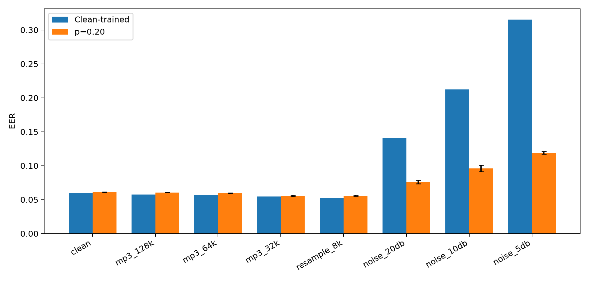

# Robust Synthetic Speech Detection under Audio Distribution Shift

A reproducible study of how synthetic-speech detectors respond to realistic audio
transformations and whether targeted augmentation can improve robustness.

> **Status:** complete. Development choices were frozen before final evaluation on 71,237 official
> ASVspoof 2019 LA EVAL trials with unseen attacks A07–A19.

## Research question

How much does a clean-trained synthetic-speech detector degrade under compression,
resampling, and additive noise, and can mixed-condition training recover performance
without sacrificing clean accuracy?

## Experimental design

- **Dataset:** ASVspoof 2019 Logical Access, official protocols validated
- **Baseline:** frozen WavLM Base Plus encoder with a compact linear head
- **Model selection:** official development split only
- **Final evaluation:** one frozen run on the previously untouched official EVAL split
- **Metrics:** EER, ROC-AUC, balanced accuracy, precision, recall, and F1
- **Shifts:** MP3 128/64/32 kbps, 8 kHz round-trip resampling, noise at 20/10/5 dB SNR
- **Mitigation:** mixed-condition corruption augmentation
- **Uncertainty:** paired utterance bootstrap intervals for corruption comparisons

## Filesystem separation

Only code, lightweight configuration, documentation, tests, small tables, and plots
belong in this repository. Audio, datasets, checkpoints, caches, and generated
corruptions remain outside Dropbox:

~~~text
Code:        ~/Dropbox/Non-coding-variant/audio-deepfake-robustness
Data:        ~/audio/data
Models:      ~/audio/models
Cache:       ~/audio/cache
Outputs:     ~/audio/outputs
Environment: ~/audio/envs/audio-deepfake
~~~

Set the artifact roots before running project commands:

~~~bash
export AUDIO_DATA_ROOT="${AUDIO_DATA_ROOT:-$HOME/audio/data}"
export AUDIO_MODEL_ROOT="${AUDIO_MODEL_ROOT:-$HOME/audio/models}"
export AUDIO_CACHE_ROOT="${AUDIO_CACHE_ROOT:-$HOME/audio/cache}"
export AUDIO_OUTPUT_ROOT="${AUDIO_OUTPUT_ROOT:-$HOME/audio/outputs}"
~~~

The repository contains no raw or transformed audio.

## Repository layout

~~~text
configs/       Versioned experiment definitions
src/           Installable Python package
scripts/       Data, training, evaluation, and reporting entry points
tests/         Fast unit and correctness tests
results/       Small metrics tables and figures only
docs/          Methodology and experiment documentation
environments/  Portable environment specification
~~~

## Environment

Python 3.11 is the target runtime. The isolated environment provides ffmpeg with
MP3 support for deterministic compression experiments.

~~~bash
conda env create --prefix "$HOME/audio/envs/audio-deepfake" \
  -f environments/environment.yml
conda activate "$HOME/audio/envs/audio-deepfake"
python -m pip install -e '.[dev]'
python scripts/check_environment.py
python -m pytest
~~~

CUDA-enabled PyTorch 2.9.1 (CUDA 12.6) is installed in the isolated environment.
Dataset preparation is separate from model training, which remains deferred.

## DEV baseline

These are development-set results used for model selection, not final evaluation.

| System | EER | ROC-AUC | PR-AUC | Balanced accuracy | F1 |
|---|---:|---:|---:|---:|---:|
| Frozen WavLM Base Plus + linear head | 0.0522 | 0.9898 | 0.9988 | 0.9500 | 0.9627 |

## DEV robustness

The frozen baseline was evaluated at its unchanged clean threshold. MP3 and an 8 kHz
round trip did not degrade ranking on DEV, while additive noise was the clear failure
mode: EER increased from 0.0522 clean to 0.1035, 0.2260, and 0.3902 at 20, 10, and
5 dB SNR. See the [Phase 4 robustness report](docs/phase4-robustness-report.md) for
paired confidence intervals, attack-specific results, score shifts, and limitations.

## Noise-augmentation result

Waveform-level Gaussian-noise augmentation reduces mean DEV EER from 0.1035 to
0.0619 at 20 dB, 0.2260 to 0.0808 at 10 dB, and 0.3902 to 0.1267 at 5 dB. The
tradeoff is a clean EER increase from 0.0522 to 0.0688. A bounded probability study
selected `p=0.20`: three-seed clean EER is 0.0583 and mean noise EER is 0.1100,
retaining 86.6% of the `p=0.50` noise gain while recovering 63.1% of its clean penalty.
See the [Phase 5 report](docs/phase5-noise-augmentation-report.md) and
[Phase 5b report](docs/phase5b-augmentation-probability-report.md).

## Final unseen-attack evaluation

The protocol was committed before evaluating 71,237 official EVAL trials containing
unseen attacks A07–A19. The selected `p=0.20` strategy preserved clean ranking EER
(0.0609 versus 0.0600 baseline) while reducing EER under 20/10/5 dB noise from
0.1406/0.2126/0.3154 to **0.0760/0.0960/0.1189**. Paired bootstrap intervals show
large noise gains; the small clean EER difference is inconclusive. MP3 and 8 kHz
resampling again produced slightly lower EER than clean audio for both strategies.

See the [final evaluation report](docs/phase6-final-evaluation-report.md) for per-seed,
A07–A19, score-shift, uncertainty, and DEV-versus-EVAL results.

## Reproduce the frozen final evaluation

~~~bash
python -m scripts.run_final_evaluation_6 --phase preflight
python -m scripts.run_final_evaluation_6 --phase condition --condition clean --device cuda:0
# Repeat the condition command for the seven remaining frozen conditions.
python -m scripts.run_final_evaluation_6 --phase analyze
~~~

Heavy datasets, caches, checkpoints, and prediction arrays remain under `~/audio`.

## Limitations

- A01–A06 occur in training; robustness to unseen attack systems is not yet measured.
- DEV selected the checkpoint and threshold, so DEV robustness results are development
  findings rather than final generalization estimates.
- The official evaluation split remains untouched.
- Compression and noise tests measure post-processing robustness, not adversarial
  robustness or every real deployment condition.

See [the methodology](docs/methodology.md) for the frozen evaluation principles.
