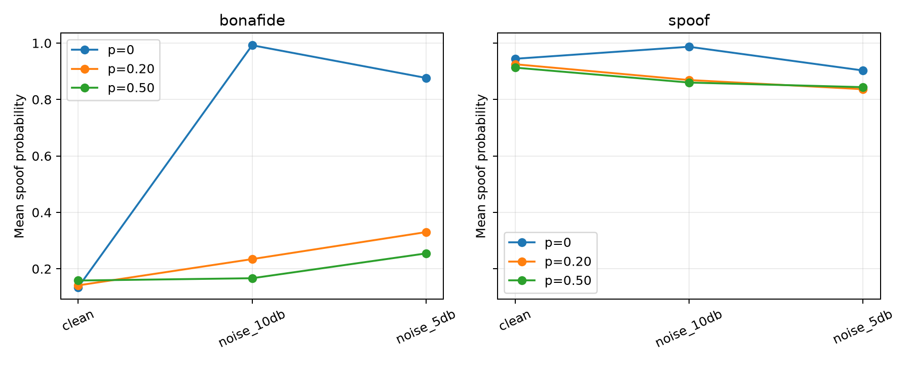

# Phase 5b — DEV-only augmentation-probability study

> **Scope:** All model selection, comparisons, confidence intervals, and conclusions use the official ASVspoof 2019 LA DEV partition. The EVAL partition was not accessed. These are development findings, not final generalization estimates.

## Motivation

Phase 5 showed that additive-noise augmentation with probability 0.50 substantially improved noise robustness but raised clean EER and especially clean A06 EER. Phase 5b changes only the probability of applying the same augmentation to ask whether a lower probability preserves most of that robustness while reducing the clean penalty.

## Controlled design

The frozen WavLM Base Plus encoder, revision, masked-mean pooling, linear classifier, class-weighted BCE, optimizer, batch size, 30-epoch schedule, deterministic Gaussian noise, uniform SNR choices `{20, 10, 5}` dB, DEV conditions, and checkpoint rule are unchanged from Phase 5. The rule minimizes mean DEV EER over clean, 20, 10, and 5 dB, then clean EER, then epoch. No external noise, codec augmentation, EVAL data, or new model component was introduced.

The development seed `20261010` was run at `p=0.20` and `p=0.35`; the existing three-seed `p=0.50` results were reused. Both lower probabilities exceeded the approximate 75% noise-gain target, but `p=0.20` recovered more clean and A06 performance, so it was selected before confirmation with seeds `20261011` and `20261012`. The single-seed `p=0.35` point remains exploratory.

## Probability sweep and tradeoff

| Aug. probability | Seeds | Clean EER | Mean noise EER | Mean 4-condition EER | Clean BA | Clean F1 | Clean A06 EER | Clean A06 recall |
|---:|---:|---:|---:|---:|---:|---:|---:|---:|
| 0.00 | baseline | 0.0522 | 0.2399 | 0.1930 | 0.9500 | 0.9627 | 0.1244 | 0.5953 |
| **0.20** | **3** | **0.0583** | **0.1100** | **0.0971** | **0.9431** | **0.9645** | **0.1512** | **0.6238** |
| 0.35 | 1 | 0.0627 | 0.0952 | 0.0870 | 0.9383 | 0.9495 | 0.1660 | 0.4518 |
| 0.50 | 3 | 0.0688 | 0.0898 | 0.0846 | 0.9338 | 0.9466 | 0.1875 | 0.4244 |


There is no single point that dominates all others. Higher augmentation probabilities improve mean noise EER but progressively worsen clean and clean-A06 EER. Confirmed `p=0.20` retains **86.6%** of the mean-noise EER improvement delivered by `p=0.50`, recovers **63.1%** of its clean-EER penalty, and recovers **57.5%** of its clean-A06 EER penalty. Relative to `p=0`, it lowers mean noise EER by 0.1299 while raising clean EER by 0.0061.

## Three-seed confirmation

| Condition | Seed 20261010 | Seed 20261011 | Seed 20261012 | Mean ± SD EER |
|---|---:|---:|---:|---:|
| Clean | 0.0578 | 0.0599 | 0.0573 | 0.0583 ± 0.0014 |
| Noise 20 dB | 0.0623 | 0.0703 | 0.0687 | 0.0671 ± 0.0042 |
| Noise 10 dB | 0.1006 | 0.1087 | 0.1042 | 0.1045 ± 0.0041 |
| Noise 5 dB | 0.1542 | 0.1633 | 0.1574 | 0.1583 ± 0.0046 |

Selected epochs were 28, 28, and 30. Clean balanced accuracy was 0.9431 ± 0.0011 and clean F1 was 0.9645 ± 0.0004. The low between-seed SDs support a stable DEV tradeoff for this fixed training procedure.

## Attack analysis

On clean DEV, A01–A05 remain stable or improve in ranking EER under `p=0.20`: their mean EERs range from 0.0030 to 0.0137, compared with 0.0039 to 0.0141 for the clean-trained baseline. Clean A06 is the exception: EER rises from 0.1244 to 0.1512, although operational recall at each seed's clean-selected threshold rises from 0.5953 to 0.6238. Thus EER and thresholded recall describe different aspects of the A06 score distribution.

At 10 and 5 dB, `p=0.20` improves EER for every A01–A06 attack relative to `p=0`. A06 mean EER changes from 0.2464 to 0.1811 at 10 dB and from 0.4058 to 0.2470 at 5 dB. A02, A05, and A06 remain the harder noisy subsets. Attack-specific operational recall can fall despite improved EER because the frozen decision threshold is selected on clean DEV.

## Paired uncertainty

The table reports selected `p=0.20` minus the comparison system. Each interval is a 2,000-replicate paired, class-stratified utterance bootstrap; each augmented system is averaged over its three predefined seeds inside every replicate. Clean A06 resamples the shared bonafide trials and A06 spoof trials, so the paired comparison is well-defined.

| Metric | vs `p=0` Δ EER [95% CI] | vs `p=0.50` Δ EER [95% CI] |
|---|---:|---:|
| Clean | +0.0061 [0.0032, 0.0089] | −0.0105 [−0.0128, −0.0085] |
| Noise 10 dB | −0.1215 [−0.1284, −0.1137] | +0.0237 [0.0210, 0.0270] |
| Noise 5 dB | −0.2320 [−0.2411, −0.2242] | +0.0316 [0.0278, 0.0352] |
| Clean A06 | +0.0268 [0.0204, 0.0334] | −0.0363 [−0.0409, −0.0311] |

These intervals quantify the frozen DEV comparison after probability selection. They do not correct for using DEV to choose `p=0.20` and should not be presented as confirmatory EVAL evidence.

## Score distributions



The clean-trained baseline's bonafide mean spoof score shifts from 0.1346 on clean audio to 0.9923 at 10 dB and 0.8765 at 5 dB. At `p=0.20`, those noisy means fall to 0.2343 and 0.3301; `p=0.50` lowers them further to 0.1666 and 0.2545. The selected lower probability therefore prevents most of the baseline's noise-induced score collapse while preserving a cleaner clean-audio distribution than `p=0.50`.

## Recommendation and limitations

Use `p=0.20` as the frozen candidate for final evaluation because it meets the stated robustness-retention heuristic and gives the best clean/A06 recovery among the qualifying candidates. This choice reflects the project's stated preference, rather than minimum four-condition mean EER; `p=0.50` remains better on mean noise EER, and `p=0.35` was evaluated with only one seed.

The augmentation uses synthetic Gaussian noise at three fixed SNRs, A01–A06 are all represented during training, the encoder remains frozen, and probability selection and reporting reuse DEV. The study does not establish robustness to unseen attacks, real acoustic environments, codecs, or EVAL. No EVAL data were accessed and no Phase 6 run was started.

## Commands and artifacts

```bash
CUDA_VISIBLE_DEVICES=0 HF_HUB_OFFLINE=1 TRANSFORMERS_OFFLINE=1 \
  python scripts/run_noise_augmentation_5.py --phase train --seed <seed> \
  --config configs/noise_augmentation_5b_p20.yaml
python scripts/analyze_augmentation_probability_5b.py
python -m pytest -q
ruff check .
```

New training plus feature extraction took about **3.9 minutes** across the four runs (`p=0.20`, three seeds; `p=0.35`, one seed) on one L40S. Heavy checkpoints and predictions remain under `~/audio`; only small tables, figures, configs, code, tests, and this report are versioned.

- Full summary: `results/metrics/augmentation-probability-summary.json`
- Probability sweep: `results/metrics/augmentation-probability-sweep.csv`
- Per-seed metrics: `results/metrics/augmentation-probability-per-seed.csv`
- Attack analysis: `results/metrics/augmentation-probability-by-attack.csv`
- Paired intervals: `results/metrics/augmentation-probability-bootstrap.json`
- Score summaries: `results/metrics/augmentation-probability-score-shifts.csv`

Phase 5b stops here.
