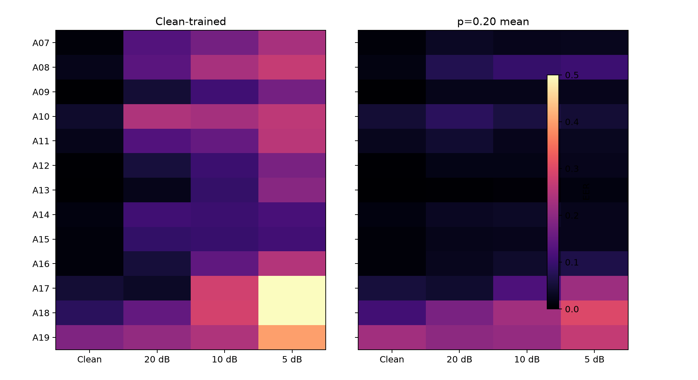

# Phase 6 — frozen final evaluation on official ASVspoof 2019 LA EVAL

> **Confirmatory scope:** This is the first frozen evaluation on the official EVAL partition. The protocol, checkpoints, thresholds, corruptions, metrics, and uncertainty procedure were committed before inference. No EVAL result was used for training, threshold selection, model selection, or method changes.

## 1. Final frozen protocol

Commit `449eff0bf8c6db4e1e3071749993475e2cf49d0f` froze `configs/final_evaluation.yaml` and the complete evaluation runner before model inference. Preflight verified a clean Git tree, all four checkpoint hashes and epochs, WavLM revision `4c66d4806a428f2e922ccfa1a962776e232d487b`, the EVAL manifest hash, corruption and metric implementation hashes, DEV thresholds, and the explicit `final_evaluation` data-access purpose. All 39 tests and Ruff passed before EVAL inference.

The eight conditions are unchanged from DEV: clean; MP3 at 128, 64, and 32 kbps; 16→8→16 kHz resampling; and deterministic Gaussian noise at 20, 10, and 5 dB. Threshold-dependent metrics use only frozen DEV thresholds. EER uses its internal score crossing solely as a threshold-free ranking metric.

## 2. Models

- **Baseline:** clean-trained frozen WavLM Base Plus encoder and lightweight head, checkpoint SHA-256 `0d16ce…fa9800`, DEV threshold `0.6937425733`.
- **Robust:** the selected `p=0.20` Gaussian-noise augmentation strategy, independently evaluated for seeds `20261010`, `20261011`, and `20261012`. Their DEV thresholds are `0.5731223226`, `0.5245580077`, and `0.4959649444`. Results report individual models and unweighted metric mean ± sample SD; scores are not ensembled.

No `p=0.35` or `p=0.50` checkpoint was evaluated on EVAL.

## 3. Official EVAL dataset

The official protocol contains exactly **71,237 trials: 7,355 bonafide and 63,882 spoof**, with 4,914 trials for each unseen attack A07–A19. All protocol paths exist, ordering is identical across conditions, IDs are unique and disjoint from TRAIN/DEV, and the 696 unreferenced FLAC files are excluded. Every condition produced exactly 71,237 finite scores for each of four checkpoints.

## 4. Unseen-attack setting

TRAIN and DEV contain A01–A06; EVAL contains A07–A19. Consequently, Phase 6 measures generalization to different benchmark spoofing systems as well as controlled post-processing shifts. It does not measure arbitrary current voice-cloning systems.

## 5. Main results

| Condition | Baseline EER | Robust EER mean ± SD | Δ EER | Baseline BA | Robust BA | Baseline F1 | Robust F1 |
|---|---:|---:|---:|---:|---:|---:|---:|
| Clean | 0.0600 | 0.0609 ± 0.0004 | +0.0009 | 0.9351 | 0.9407 | 0.9392 | 0.9512 |
| MP3 128k | 0.0575 | 0.0606 ± 0.0003 | +0.0031 | 0.9405 | 0.9433 | 0.9454 | 0.9561 |
| MP3 64k | 0.0571 | 0.0594 ± 0.0004 | +0.0023 | 0.9420 | 0.9445 | 0.9471 | 0.9586 |
| MP3 32k | 0.0544 | 0.0556 ± 0.0008 | +0.0012 | 0.9492 | 0.9356 | 0.9670 | 0.9727 |
| Resample 8k | 0.0528 | 0.0558 ± 0.0007 | +0.0030 | 0.9490 | 0.9465 | 0.9664 | 0.9605 |
| Noise 20 dB | 0.1406 | 0.0760 ± 0.0026 | −0.0645 | 0.5187 | 0.9229 | 0.9469 | 0.9557 |
| Noise 10 dB | 0.2126 | 0.0960 ± 0.0046 | −0.1166 | 0.5001 | 0.8960 | 0.9413 | 0.9548 |
| Noise 5 dB | 0.3154 | 0.1189 ± 0.0020 | −0.1965 | 0.5374 | 0.8541 | 0.9150 | 0.9448 |

Negative Δ EER favors the robust strategy. The complete tables retain ROC-AUC, PR-AUC, precision, recall, per-seed metrics, and confusion matrices.

## 6. Clean generalization

| Model | DEV clean EER | EVAL clean EER | EVAL − DEV |
|---|---:|---:|---:|
| Baseline | 0.0522 | 0.0600 | +0.0078 |
| Robust `p=0.20` | 0.0583 | 0.0609 | +0.0026 |

The clean baseline generalizes reasonably but declines modestly on unseen attacks. Robust clean EER is nearly unchanged from the baseline on EVAL, despite its larger DEV penalty. At frozen operating thresholds, robust training improves EVAL balanced accuracy by 0.0056 and F1 by 0.0120, largely through 0.0229 higher spoof recall, while ROC-AUC is 0.0007 lower. Clean EER's paired interval includes zero, so the small ranking difference is not reliable under the frozen bootstrap.

## 7. Robustness generalization

| Model | Condition | DEV Δ from clean | EVAL Δ from clean |
|---|---|---:|---:|
| Baseline | Noise 20 dB | +0.0513 | +0.0805 |
| Baseline | Noise 10 dB | +0.1738 | +0.1525 |
| Baseline | Noise 5 dB | +0.3380 | +0.2553 |
| Robust `p=0.20` | Noise 20 dB | +0.0087 | +0.0151 |
| Robust `p=0.20` | Noise 10 dB | +0.0462 | +0.0351 |
| Robust `p=0.20` | Noise 5 dB | +0.0999 | +0.0579 |

The main DEV finding generalizes: clean training is strongly vulnerable to additive noise, while `p=0.20` substantially limits degradation. Absolute values differ because EVAL contains unseen attacks and a different data distribution.

## 8. Unseen attack A07–A19 analysis

On clean EVAL, the hardest attacks for both strategies are **A19** (baseline/robust EER 0.2188/0.2247), **A18** (0.0960/0.1081), and **A17** (0.0586/0.0563). The easiest are A13, A09, and A12. Robust training lowers clean attack-specific EER for 10 of 13 attacks, with the largest clean reductions on A08 and A15; it raises EER on A11, A18, and A19. Thus the effect is not uniform across unseen spoofing systems.

Under 5 dB noise, robust training improves EER for every A07–A19 attack. The largest reductions occur for A17 (−0.3725), A18 (−0.2950), and A11 (−0.2724); A18 and A19 remain difficult.

## 9. Noise robustness

| SNR | Baseline EER | Robust EER | Absolute reduction | Relative reduction |
|---:|---:|---:|---:|---:|
| 20 dB | 0.1406 | 0.0760 | 0.0645 | 45.9% |
| 10 dB | 0.2126 | 0.0960 | 0.1166 | 54.8% |
| 5 dB | 0.3154 | 0.1189 | 0.1965 | 62.3% |

Balanced-accuracy gains are 0.4042, 0.3959, and 0.3167 respectively. These values expose the baseline's class-wide shift more clearly than its apparently high recall/F1, which benefit from predicting most trials as spoof in this imbalanced dataset.

## 10. Codec and resampling findings

The unexpected DEV observation replicates descriptively. Relative to clean EER, the baseline improves by 0.0025, 0.0029, 0.0057, and 0.0073 under MP3 128/64/32k and resampling; robust EER improves by 0.0003, 0.0015, 0.0053, and 0.0051. This is a repeated empirical pattern under the fixed benchmark pipeline, not evidence for a mechanism or a claim that lossy processing generally improves detection.

## 11. Score-shift analysis

For baseline bonafide trials, mean spoof probability rises from 0.0894 clean to 0.9913 at 10 dB and 0.8727 at 5 dB. Robust training limits those means to 0.2222 and 0.3176. Spoof means remain high: 0.9030 and 0.8973. The severe DEV class-wide shift toward spoof therefore also occurs on EVAL for the clean-trained baseline and is substantially reduced by `p=0.20`.

## 12. Paired model comparison

Averaged descriptively across the three robust seeds, clean EVAL has roughly 1,909 baseline-wrong/robust-correct trials versus 534 baseline-correct/robust-wrong trials. At 10 dB these counts are about 6,731 versus 4,454, and at 5 dB about 7,515 versus 3,363. These operational transitions use each model's frozen DEV threshold. Complete per-seed and A07–A19 transition counts are retained in the result table.

## 13. Statistical uncertainty

The frozen analysis uses 2,000 paired, class-stratified EVAL-utterance bootstrap replicates. Differences are robust mean minus baseline.

| Condition | Δ EER [95% CI] | Δ ROC-AUC [95% CI] | Δ BA [95% CI] | Δ F1 [95% CI] |
|---|---:|---:|---:|---:|
| Clean | +0.0009 [−0.0004, 0.0026] | −0.0007 [−0.0011, −0.0003] | +0.0056 [0.0042, 0.0071] | +0.0120 [0.0112, 0.0128] |
| Noise 20 dB | −0.0645 [−0.0674, −0.0611] | +0.0452 [0.0434, 0.0469] | +0.4042 [0.4006, 0.4078] | +0.0088 [0.0077, 0.0099] |
| Noise 10 dB | −0.1166 [−0.1203, −0.1125] | +0.1232 [0.1203, 0.1260] | +0.3959 [0.3916, 0.4000] | +0.0135 [0.0123, 0.0146] |
| Noise 5 dB | −0.1965 [−0.2004, −0.1924] | +0.2052 [0.2010, 0.2093] | +0.3167 [0.3104, 0.3229] | +0.0298 [0.0284, 0.0312] |

The noise advantages are large and their intervals exclude zero for all four metrics. Clean results are mixed: EER is inconclusive, ROC-AUC is slightly lower, and frozen-threshold BA/F1 are higher.

## 14. DEV versus EVAL comparison

| Model | Condition | DEV EER | EVAL EER | Difference |
|---|---|---:|---:|---:|
| Baseline | Clean | 0.0522 | 0.0600 | +0.0078 |
| Baseline | Noise 20 | 0.1035 | 0.1406 | +0.0371 |
| Baseline | Noise 10 | 0.2260 | 0.2126 | −0.0134 |
| Baseline | Noise 5 | 0.3902 | 0.3154 | −0.0749 |
| Robust `p=0.20` | Clean | 0.0583 | 0.0609 | +0.0026 |
| Robust `p=0.20` | Noise 20 | 0.0671 | 0.0760 | +0.0090 |
| Robust `p=0.20` | Noise 10 | 0.1045 | 0.0960 | −0.0085 |
| Robust `p=0.20` | Noise 5 | 0.1583 | 0.1189 | −0.0394 |

The absolute distribution changes, but all principal DEV conclusions survive: severe baseline noise sensitivity, substantial mitigation from controlled augmentation, a probability-dependent clean/noise tradeoff, and small codec/resampling EER improvements.

## 15. Limitations

- ASVspoof 2019 is a benchmark and does not capture all modern synthetic-speech systems.
- Gaussian noise is a controlled corruption rather than realistic environmental or channel noise.
- Compression and additive corruption are not adversarial attacks.
- Only a frozen WavLM encoder with a lightweight classification head was studied.
- No real telephony transmission chain was evaluated.
- No external-dataset generalization has been tested.
- Attack IDs represent benchmark synthesis/spoofing systems, not the full current deepfake landscape.
- Confidence intervals characterize this fixed EVAL benchmark and do not remove dataset-level uncertainty.

## 16. Conclusions

The clean-trained detector generalizes reasonably to unseen attacks on clean audio but remains highly sensitive to additive noise. The DEV-selected `p=0.20` strategy preserves clean EER while delivering large, statistically clear gains under 20, 10, and 5 dB noise. Augmentation probability materially controls the clean-versus-noise tradeoff. Results support claims about measured controlled shifts and unseen ASVspoof attack systems, not production readiness, adversarial robustness, or universal protection against voice cloning.

Heavy features and prediction arrays remain outside Git under `~/audio`. Parallel inference wall time was about 17.4 minutes on eight L40S GPUs; the exact 2,000-replicate analysis took about 22 minutes. Feature caches use 1.7 GiB and final run outputs 7.3 MiB.

## Communication-ready descriptions

**One-line resume bullet:** Built a reproducible WavLM audio-deepfake robustness pipeline on 71k held-out ASVspoof trials, reducing EER by 46–62% under 20–5 dB noise while preserving clean unseen-attack EER.

**Two-bullet version:**

- Built a frozen-WavLM synthetic-speech detector with protocol-guarded ASVspoof data preparation, deterministic corruption testing, paired bootstrap uncertainty, and reproducible single/multi-GPU evaluation.
- Identified severe clean-model noise sensitivity and selected a controlled augmentation tradeoff that preserved 0.061 clean EER while reducing held-out noise EER from 0.141/0.213/0.315 to 0.076/0.096/0.119 at 20/10/5 dB.

**LinkedIn/project description:** Developed an end-to-end robustness study for synthetic-speech detection using ASVspoof 2019 LA and a frozen WavLM encoder. I measured failures under codecs, resampling, and additive noise, ran controlled augmentation-probability experiments on DEV, then committed a frozen protocol before evaluating 71,237 untouched EVAL trials containing unseen attacks A07–A19. The selected model preserved clean EER and reduced noise EER by 46–62%, with paired bootstrap intervals and attack-level failure analysis. The project includes isolated data access, deterministic transformations, external artifact storage, tests, configs, and reproducible reporting.

**60-second interview explanation:** I wanted to test whether a strong audio deepfake detector was actually robust outside clean benchmark audio. I froze WavLM and trained only a small head, then evaluated deterministic MP3, resampling, and Gaussian-noise shifts. The clean model looked strong on clean DEV but collapsed under noise because bonafide scores shifted toward spoof. I compared augmentation probabilities without changing other variables and selected `p=0.20` as a clean-versus-robustness compromise. Before touching EVAL, I committed every checkpoint hash, threshold, corruption, metric, and bootstrap setting. On 71,237 unseen-attack trials, clean EER stayed near 0.061, while noise EER fell by 46–62%. The main lesson is that aggregate clean accuracy hides deployment-relevant failures, and controlled evaluation plus predeclared protocols makes mitigation claims much more credible.
